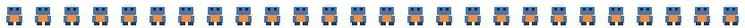
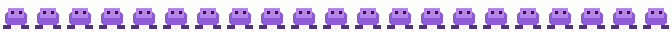
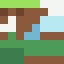
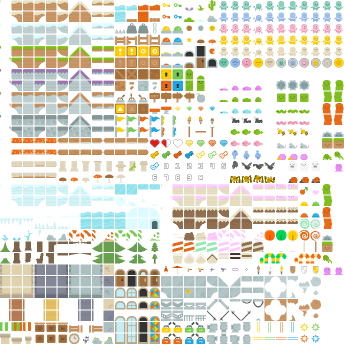

# Mario Platformer Fan Project

Mario Platformer Fan Project is an unofficial, noncommercial 2D platformer prototype built with Godot 4.7 and GDScript. Run through a bright meadow, collect coins and power-ups, defeat enemies, restore at checkpoints, and enter the castle at the end of the course.

The project focuses on responsive platforming, readable pixel-art environments, and a complete short-form game loop from title screen to victory.

## Project status

This is an active prototype and a complete playable slice. It is a fan-made project and is not affiliated with or endorsed by Nintendo. The repository is intended for development and experimentation rather than commercial release.

## Features

- Responsive keyboard and gamepad movement with sprinting and variable-height jumps
- Coins, question blocks, growth and fire power-ups, fireballs, and temporary invulnerability stars
- Walkers, faster turtles, player-seeking hunters, and pop-up plant enemies
- Checkpoint restoration, score and fastest-time records, pause, victory, and death screens
- A daytime meadow that transitions through a pipe into a moonlit castle section
- Landscape mobile controls for Android and iOS, including simultaneous touch input
- Separate music and sound effects for the game worlds and interactions

## Run locally

1. Install [Godot 4.7](https://godotengine.org/download/) or newer.
2. Clone this repository and open `project.godot` in Godot.
3. Press **F6** or **F5** to run the game.

### Controls

| Action | Keyboard | Gamepad |
| --- | --- | --- |
| Move | **A/D** or arrow keys | Left stick or D-pad |
| Jump | **Space** | South button |
| Sprint | **Shift** or **X** | West button |
| Fire | **F** or **C** after collecting a flower | East button |
| Enter pipe | **S** or Down | D-pad down |
| Pause | **Escape** | Start |

On mobile, the game automatically provides left, right, down, run, fire, jump, and pause buttons in landscape mode.

## Mobile export

Android and iOS presets are included in `export_presets.cfg`. Install the matching Godot export templates and use **Project → Export**. Android requires an Android SDK; iOS export requires Xcode and an Apple signing team.

## Automated checks

On macOS, run:

```sh
/Applications/Godot.app/Contents/MacOS/Godot --headless --path . tests/test_runner.tscn
```

Replace the executable path for another Godot installation. The test runner covers scene construction, movement tuning, sprint limits, variable jumping, checkpoint restoration, damage transitions, and pause behavior.

## Assets

The project assets are grouped by purpose so they can be replaced or expanded independently:

- **Original game art**: [hero sheet](assets/original/hero_sheet.svg), [enemy sheet](assets/original/enemy_sheet.svg), [item sheet](assets/original/items_sheet.svg), [meadow tiles](assets/original/overworld_tiles.svg), and [castle tiles](assets/original/castle_tiles.svg).
- **Kenney pixel art**: [platformer atlas](assets/kenney/platformer_atlas.png) and [backgrounds](assets/kenney/backgrounds.png), released under CC0. See the [Kenney license](assets/kenney/LICENSE.txt).
- **Music**: [Flowerbed Fields](assets/audio/flowerbed_fields.ogg) and [Going Up](assets/audio/going_up.ogg). Source and license information is in [MUSIC_LICENSE.txt](assets/audio/MUSIC_LICENSE.txt).
- **Sound effects**: gameplay, impact, fire, portal, coin, jump, and UI sounds in [assets/audio](assets/audio/).

To change the art or audio, replace the corresponding source file, let Godot reimport it, and update this list and [LICENSES.md](LICENSES.md) when the source or license changes.

### Visual asset reference

These previews use the real image files currently in the project. Select any image to open the full-resolution source.

<table>
	<tr>
		<td align="center"><a href="assets/original/hero_sheet.svg"></a><br>Hero sheet</td>
		<td align="center"><a href="assets/original/enemy_sheet.svg"></a><br>Enemy sheet</td>
		<td align="center"><a href="assets/original/items_sheet.svg"></a><br>Item sheet</td>
	</tr>
	<tr>
		<td align="center"><a href="assets/original/overworld_tiles.svg"></a><br>Meadow tiles</td>
		<td align="center"><a href="assets/original/castle_tiles.svg"></a><br>Castle tiles</td>
		<td align="center"><a href="assets/kenney/platformer_atlas.png"></a><br>Kenney atlas</td>
	</tr>
</table>

## Asset and publishing notes

Third-party asset sources and licenses are documented in [LICENSES.md](LICENSES.md). The gameplay art in `assets/original/` was created for this project. The old local files in `assets/user_provided/` are ignored and are not part of the public project.
